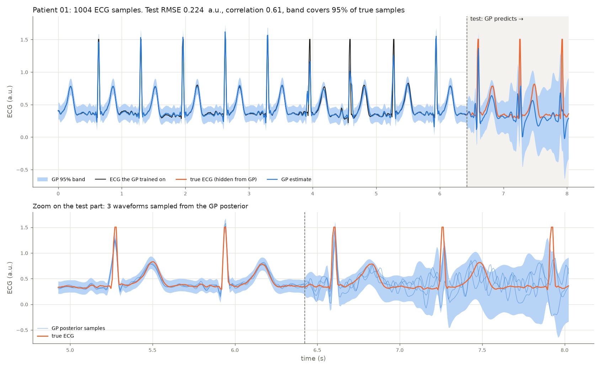
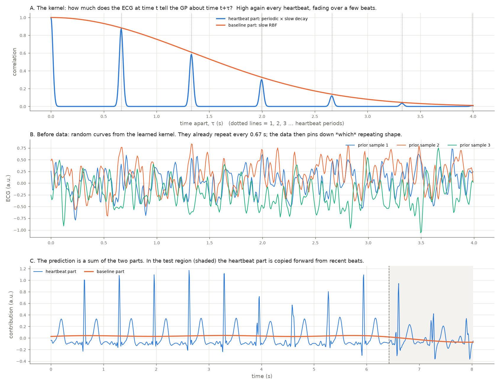
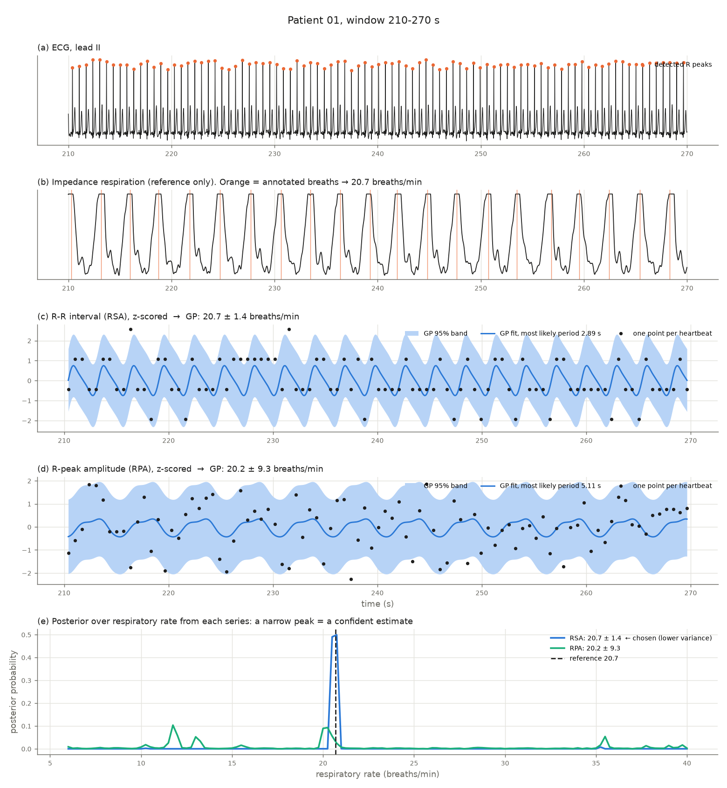
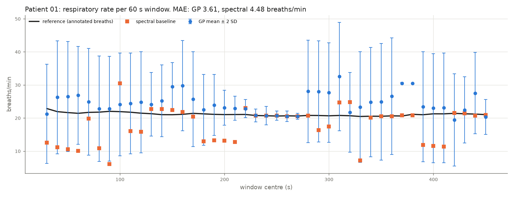

# Gaussian Process for Respiratory Rate

Gaussian processes (GPyTorch) on ECG signals from the
[BIDMC PPG and Respiration Dataset](https://physionet.org/content/bidmc/1.0.0/):

1. **ECG waveform forecasting.** A locally periodic GP learns the heartbeat and predicts unseen ECG.
2. **Respiratory rate from the ECG.** A reproduction of Pimentel, Clifton, Clifton & Tarassenko,
   [*Probabilistic Estimation of Respiratory Rate using Gaussian Processes*](https://www.robots.ox.ac.uk/~davidc/pubs/embc2013_gpbr.pdf),
   IEEE EMBC 2013.

Plus a from-scratch implementation of the BBMM inference behind GPyTorch ([below](#bbmm-from-scratch)).

All results so far are on BIDMC patient 01.

## 1. ECG waveform forecasting — `ecg_waveform_gp.py`

1004 ECG samples (8 s at 125 Hz). The GP trains on the first 803 and predicts the last 201.
Kernel: `Periodic × RBF` (beats repeat, drifting slowly) `+ RBF` (baseline wander).

| Test metric (last 1.6 s, unseen) | Value |
|---|---|
| Correlation with true ECG | 0.61 |
| 95% band coverage | 95% |
| Learned period | 0.665 s = 90.2 beats/min |





## 2. Respiratory rate (Pimentel et al. 2013) — `gp_respiratory_rate.py`

For each 60 s window (10 s step):

1. Detect R peaks.
2. Build two beat-by-beat series that breathing modulates: R-peak amplitude (RPA) and R-R interval (RSA).
3. Fit a periodic GP to each series across a grid of periods P (6–40 breaths/min). Normalise the
   marginal likelihoods into a posterior over P, and take respiratory rate = 60 / P.
4. Keep whichever series gives the lower posterior variance.

The reference is the manual breath annotations. The baseline is the spectral peak of each series.

| Patient 01, 43 windows | GP | Spectral baseline |
|---|---|---|
| MAE (breaths/min) | **3.61** | 4.48 |
| Reference within mean ± 2 SD | 93% | — |

The GP's uncertainty is informative. Windows with posterior SD < 2 have MAE 2.59; windows with SD ≥ 5 have MAE 4.07.
Full log: `gp_rr_log_01.txt`.





### Notes

- A free periodic lengthscale lets short periods fit beat-to-beat noise (MAE 10.6). Fixing it at 1,
  as in the paper, fixes this.
- The CSV time column is rounded to 0.01 s after 100 s, so the sampling rate is computed from the total duration.
- BIDMC has no blood pressure signal, so BP cannot be estimated or validated with it.
- `respiratory_rate.py` (a multi-patient, feature-based GP over PPG + ECG) needs the full dataset and has not been run yet.

## Run

```bash
python3 -m venv .venv && .venv/bin/pip install torch numpy scipy matplotlib gpytorch
mkdir -p data && cd data
curl -O https://physionet.org/files/bidmc/1.0.0/bidmc_csv/bidmc_01_Signals.csv
curl -O https://physionet.org/files/bidmc/1.0.0/bidmc_csv/bidmc_01_Breaths.csv
cd ..
.venv/bin/python ecg_waveform_gp.py 1
.venv/bin/python gp_respiratory_rate.py 1
```

Data: Pimentel et al., BIDMC PPG and Respiration Dataset v1.0.0, PhysioNet (ODC Attribution License).

---

## BBMM from scratch

A from-scratch PyTorch implementation of **Blackbox Matrix-Matrix (BBMM) GP inference**
from *GPyTorch: Blackbox Matrix-Matrix Gaussian Process Inference with GPU Acceleration*
(Gardner, Pleiss, Bindel, Weinberger, Wilson — NeurIPS 2018, [arXiv:1809.11165](https://arxiv.org/abs/1809.11165)).

The model only provides a routine for `K_hat @ M`. Everything else (solves, log-determinant,
gradients and predictions) comes from a single batched CG call.

### Step-by-step map to the paper

| Step | File | Paper |
|---|---|---|
| 1. Preconditioned CG | `bbmm/cg.py` | Algorithm 1 |
| 2. mBCG: batched solves + Lanczos tridiagonals from the CG coefficients | `bbmm/mbcg.py` | Algorithm 2, eq. 3, Obs. 3 / eq. S5 |
| 3. Log-determinant via stochastic Lanczos quadrature | `bbmm/slq.py` | eq. 5, 6, 8, S7 |
| 4. Pivoted Cholesky preconditioner (solve, log\|P\|, sampling) | `bbmm/pivoted_cholesky.py` | Sec. 4.1, App. C |
| 5. Blackbox operators: exact, SGPR/SoR, Bayesian linear regression | `bbmm/operators.py` | Sec. 5 |
| 6. MLL, its gradient (trace estimator) and predictions | `bbmm/inference.py` | eq. 1, 2, 4, 7, 9 |

How the gradient works: one call to mBCG on `[y, z_1..z_t]` (with `z_i ~ N(0, P)`) returns
`u = K^-1 y` and `K^-1 z_i`. The surrogate
`S(θ) = (1/t) Σ <K^-1 z_i, K(θ) P^-1 z_i> − <u, K(θ) u>` (with its vectors held fixed) has gradient
`Tr(K^-1 dK/dθ) − yᵀK^-1 dK/dθ K^-1 y`, which is eq. 2/9. Building it takes one more blackbox
matmul, and autograd does the rest, so no derivative code is written for any model.

Note: the printed Algorithm 2 has sign typos (`R0 = A U0 − B` and `D = Z − βD`). This code uses
the standard CG signs.

`step_by_step.py` checks each step against dense Cholesky ground truth, then trains an exact GP
with Adam on the BBMM marginal log-likelihood. A gentler numpy walkthrough is in `learn/`.

```bash
.venv/bin/python step_by_step.py
```
